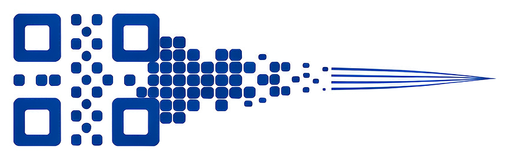

<p align="center">
  
</p>

# 方寸 · Square

<p>
  
  
  
  
  
</p>

> 方寸之间，藏尽千言

方寸是一个专门针对长文本优化的文本与二维码互转工具。

## 功能

### 生成

- **长文本自动分片**：内容放不进单个码时，按当前纠错率与清晰度切分为多片，每片带 24 字符协议帧头（v2：17 字节二进制，含总片数、片号、原始字节数、压缩标记与整条内容 CRC32），可在多张图之间按片号重组。
- **四种编码策略**：

  | 策略 | 实际行为 | 适用场景 |
  | --- | --- | --- |
  | 自动（推荐） | 先尝试把整段文本编成一个标准二维码（不加帧头）；放不下才转分片 | 绝大多数情况，短文本得到普通二维码 |
  | 强制单码 | 只生成一个码；超出当前纠错率的单码容量时直接报错，并给出容量与超出字节数 | 必须只用一个码，例如印在名片、贴纸上 |
  | 强制分片 | 跳过单码尝试，始终按分片协议编码（内容再短也带帧头） | 需要统一分片格式，或后续按片号累积收集 |
  | 压缩+分片 | 先对 UTF-8 字节做 zlib 压缩，再 base64 分片，片段带压缩标记 | 长文本、重复度高的文本，能明显减少片数 |

- **纠错率四档**：最低（L，约 7%）、中等（M，约 15%，默认）、较高（Q，约 25%）、最高（H，约 30%）。版本 40、byte 模式下的单码容量分别为 2953 / 2331 / 1663 / 1273 字节。
- **清晰度四档**：紧凑 / 平衡 / 清晰 / 最清晰，对应每片整帧上限 1700 / 1300 / 1000 / 750 字符。上限越大分片越少、单码模块越密；实际生效值为 `min(档位上限, 当前纠错率单码容量 - 24 字符帧头)`，参数区会提示被容量压低后的实际值。
- **保存二维码**：把当前所有分片按每行最多 4 张拼成一张 PNG 保存，默认文件名 `qrcode.png`。
- **大图预览**：点击预览区打开弹窗，缩放范围 5%–200%，支持滑杆、鼠标滚轮与「适应窗口」，图片超出视口时自动显示滚动条。

### 还原

- **三条入口**：选择图片（png / jpg / jpeg / bmp / gif，也可在「所有文件」中选其他格式）、读取剪贴板（图片或复制的图片文件）、区域截图。
- **区域截图跨屏取图**：半透明遮罩铺满虚拟桌面，可跨多显示器框选；Esc 或右键取消；抓取真实屏幕像素后同时写入剪贴板并送入解码器。
- **密集二维码切块二次识别**：整图识别不理想时，先用局部均值阈值求墨迹掩膜，按白色分隔带切块；遇到码贴码则用投影自相关估计码块周期，枚举相位生成网格逐格重试，并补静默区、自动对比、多尺度与锐化。
- **多张截图累积拼合**：分片来自多次截图/多张图片时按片号去重累积（同片保留更完整的一份），收齐即还原；总片数、原始长度或压缩标记变化时自动清空旧池，也可手动清空重新收集。
- **分片进度**：状态行显示「共 N 片，已收集…，缺失…」，并列出片号，便于判断还差哪几张。

## 使用要点

- **压缩+分片生成的码只有本软件能还原**：通用扫码器读到的是 base64 编码字符串（含协议帧头），不是原始文本。选择该策略时参数区会直接提示。
- **短文本一律生成标准二维码**：代码中显式禁用了 Micro QR。Micro QR 不被 pyzbar / zbar 识别，通用扫码器同样读不出，会把短内容的可用性直接毁掉。
- **纯文本单码声明 ECI 26（UTF-8）**：不带 ECI 标记时，扫码端只能猜载荷编码；zbar 在中文 UTF-8 恰好也是合法 Shift-JIS 时会按 SJIS 解读，扫出「蜀ｻ蟷ｲ…」式乱码。生成时显式写入 ECI（UTF-8 设计符）后，两端都按 UTF-8 读取。纯 ASCII 内容 segno 不会写入 ECI，单码容量不受影响。
- **分片帧头升级到 v2**：17 字节二进制（转成 24 字符 base64 前缀），在原 v1 的总片数、片号、原始字节数、压缩标记之外增加整条内容的 CRC32。分片来自不同消息、但总片数与字节数恰好相同时，v1 会在按片号覆盖后拼出错误内容，v2 则在重组时直接判定「内容校验不通过」并拒绝。v1 旧分片码（20 字符帧头）仍可正常读取。
- 分片拼图建议交给本软件识别；通用扫码器对整张拼图通常只能读到其中个别码。

## 直接下载使用

不想装 Python 的话，直接取打包好的单文件程序：

- 下载地址：<https://github.com/theanswer910725/square/releases>（当前版本 **v1.1.0**）
- 两个资产，按目标系统选择：
  - `Square.exe`：Windows 10 / 11 x64，约 25.6 MiB
  - `Square-Win7.exe`：Windows 7 SP1（x64 / x86 均可），需系统已装 KB2999226（通用 C 运行库）。该线基于已停止维护的 Python 3.8，仅作兼容维护，不再跟进安全更新
- Windows 单文件，无需安装 Python，双击即用
- **建议安装 [VC++ 2013 运行库](https://aka.ms/highdpimfc2013x64chs)**（提供 `MSVCR120.dll`）：解码依赖的 `libzbar` 静态依赖它。打包流程通常已把该 DLL 收进包内，缺失时程序仍可启动并生成二维码，但**解码功能不可用**

## 环境要求

- **Python 3.13**（开发、回归与打包均在 3.13.8 上实测通过）；Windows 7 兼容线用 **Python 3.8**
- **Windows**：剪贴板图片写入（CF_DIB）、虚拟桌面/多显示器截图、DPI 坐标换算均直接调用 Win32 API，不支持 macOS / Linux。
- 依赖按线锁定版本，不用 `>=`（避免重建时漂移）：
  - 现代系统线 `requirements.txt`：`customtkinter==6.0.0`、`pillow==12.0.0`、`numpy==2.2.6`、`segno==1.6.6`、`pyzbar==0.1.9`
  - Windows 7 线 `requirements-win7.txt`：`pillow==10.4.0`、`numpy==1.24.4`，其余同上，另加 `pyinstaller==5.13.2`
  - 双线方案与版本依据见 `docs/win7-support-plan.md`
- pyzbar 在 Windows 上通过 ctypes 加载包内自带的 `libzbar-64.dll`（32 位构建为 `libzbar-32.dll`）与 `libiconv.dll`，无需另行安装 zbar。`libzbar` 还静态依赖 **`MSVCR120.dll`（Visual C++ 2013 运行库）**：打包时通常已随包收进，若包内缺失则需安装 [vcredist 2013](https://aka.ms/highdpimfc2013x64chs)，否则解码功能不可用（生成不受影响）。

## 运行

```bash
pip install -r requirements.txt
python main.py
```

窗口标题为「方寸 · Square」，顶部可在「生成器」与「解码器」之间切换。

## 测试

回归用例在 `tests/test_qr_encoding.py`，不依赖 pytest，直接运行：

```bash
python tests/test_qr_encoding.py
```

覆盖内容：

- **用户乱码案例**：报告中的「冻干粉大富大贵」长短行交替文本（510 字符）走 core 层单码往返，自动策略必须选中 `single-plain`，扫码还原后逐字一致
- **GUI 层同一条链路**：真实窗口输入该文本 → 生成 → 对预览拼图识别 → 还原，逐字一致（需要显示环境）
- **中文长文本三策略**：约 3000 字符的中文长文本分别走自动 / 强制分片 / 压缩+分片，全部往返一致（分片路径会真实走一遍帧头与 CRC 校验）
- **ASCII 与中英混排**：确认声明 ECI 后原有内容与单码容量都不受影响

用例直接用 pyzbar 扫描渲染出的 PNG，走的是与真实使用相同的「编码 → 扫码 → 解码」链路；末尾输出 `N PASS / N FAIL`，有失败时退出码非 0。

## 打包

使用 PyInstaller 单文件、无控制台打包，产物为 `dist/Square.exe`：

```bat
build_exe.bat
```

等价命令：

```bash
python -m PyInstaller --noconfirm square.spec
```

- 实测产物约 **25.6 MiB**，启动约 **3.5 秒**（热启）/ 约 6 秒（冷启，onefile 先自解压到临时目录）。
- `square.spec` 中的排除项均经启动、生成、保存、两条解码路径与截图识别回归确认：

  | 排除项 | 原因 | 省下体积 |
  | --- | --- | --- |
  | `PIL.AvifImagePlugin` | 界面不提供 avif | 约 4.1 MiB |
  | `PIL.ImageCms` | 未使用色彩管理 | 几十 KB（纯 Python 代码） |
  | `ssl`、`_ssl` | 本地工具不联网 | 约 0.4 MiB |
  | `_hashlib` | 同上，是 `libcrypto-3.dll` 的来源 | 约 1.8 MiB |
  | `setuptools`、`pkg_resources` | 仅打包期依赖，运行时无引用 | 约 1.1 MiB |

- **保留** WebP（文件对话框允许「所有文件」，去掉会导致 .webp 打不开）、numpy（密集切块的图像分析）、PIL、pyzbar 的 `libzbar-64.dll` / `libiconv.dll`，以及 customtkinter 的主题 json 与字体资源。
- 不使用 UPX 或其它加壳手段。
- `square.spec` 与 `build_exe.bat` 均已在版本库内，可直接复用，无需自己重写打包配置。

### Windows 7 兼容线

Python 3.13 的运行时依赖 `api-ms-win-core-path-l1-1-0.dll`（Windows 8 起才有），Win7 上无法启动，因此单开一条 Python 3.8 构建线：

```bat
build_win7.bat
```

- 解释器按「命令行参数 → `.venv-win7\Scripts\python.exe` → 已知 3.8 路径」选取，不加入系统 PATH。
- `square-win7.spec` 剔除 `api-ms-win-*.dll` 与 `ucrtbase.dll`（必须由目标机 OS 提供），并按解释器位宽自动选 `libzbar-32.dll` / `libzbar-64.dll`。
- 构建结束自动执行 `tools/check_bundle.py` 校验包内容，不通过即中断。
- 方案、版本依据与验证清单见 `docs/win7-support-plan.md`。

## 目录结构

```text
main.py                 启动入口，调用 square.gui.run
requirements.txt        运行依赖
requirements-win7.txt   Windows 7 线依赖（Python 3.8 锁版）
build_exe.bat           一键打包（清 build/dist → PyInstaller）
square.spec             PyInstaller 打包配置（onefile、无控制台、排除项）
build_win7.bat          Windows 7 线打包（PATH 隔离 + 构建后自检）
square-win7.spec        Windows 7 线打包配置（剔除 Win8+ API set、位宽自适应）
tools/
  check_bundle.py       构建后自检：包内不得含 api-ms-win-* / ucrtbase.dll
docs/
  win7-support-plan.md  双构建线方案与验证结论
tests/
  test_qr_encoding.py   中文二维码回归：单码 ECI 与三种分片策略往返
square/
  __init__.py
  core/                 纯逻辑层，不依赖 Tk
    __init__.py
    codec.py            编码、分片协议、帧解析与重组
    tiles.py            密集拼接图的切块二次识别
    puzzle.py           多张二维码合成为一张预览/保存图
    clipboard.py        以 CF_DIB 写入 Windows 剪贴板
  gui/                  界面层
    __init__.py
    app.py              主窗口、生成器/解码器页面与各入口动作
    capture.py          区域截图遮罩、跨屏抓图与结果分发
    preview.py          大图预览弹窗（缩放、滚动条显隐）
    theme.py            Win11 浅色 Fluent 色板、下拉框/滚动条/遮罩配色、圆角与字体栈
    widgets.py          下拉框、悬停提示、图标绘制与字体挑选
    assets/             应用图标
```

## 许可证

本项目使用 MIT 许可证，详见 [LICENSE](LICENSE)。
